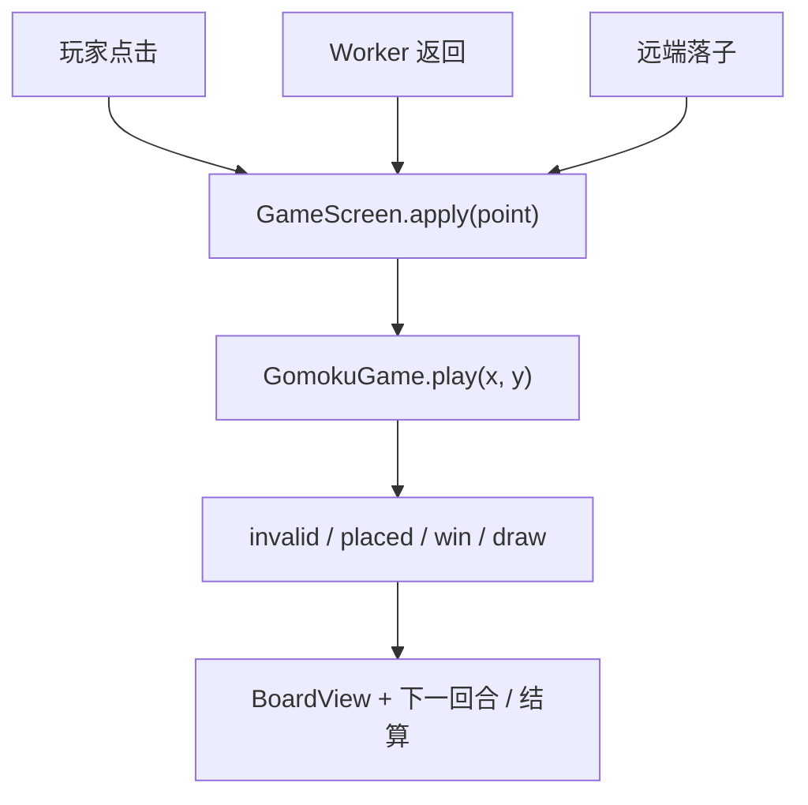
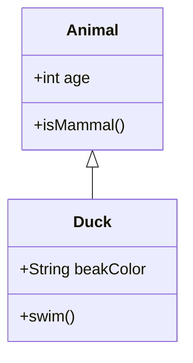

# 文章图表

编辑器的插入菜单中选择 **Code Drawing**，或在空段落输入 `/mermaid` 后选择 Code Drawing。格式菜单提供 Mermaid、PlantUml、Graphviz、Flowchart；视图菜单提供「源码与图表」「仅源码」「仅图表」。

文章显示方式、编辑器格式和视图均使用项目的 Select 组件，不使用浏览器原生下拉。菜单支持方向键选择、Enter 确认、Esc 关闭并返回焦点，跟随当前页面或编辑器的深浅色主题；弹层独立于图表的裁切容器。

输入 `/excalidraw` 或从插入菜单选择 **Excalidraw** 可打开手绘画布。保存文章会保留图形、画布背景及嵌入图片，重新编辑时仍可继续修改。文章页显示静态图，并提供 SVG 和 `.excalidraw` 源文件下载。

普通代码块的语言设为 `mermaid`、`plantuml` / `puml`、`graphviz` / `dot` 或 `flowchart`，文章页也会识别为图表。其他代码语言继续语法高亮。普通文本/ASCII 箭头不会自动转换；需改写成对应语法。

例如五子棋的调用流程可以写为：

类图使用 Mermaid 的 `classDiagram`，不是普通代码高亮：

Mermaid、Graphviz、Flowchart 和 Excalidraw 在浏览器内渲染。PlantUML 使用官方 `plantuml.com` 服务，会向该服务发送图表源码，编辑器选择此格式时会提示。渲染失败时保留源码，文章页可重试。

文章页的 Mermaid 源码由本地依赖 [Pele](https://github.com/obsidianmd/pele) 渲染，固定版本 `1.6.0`，通过 `pele/lazy` 按图表类型加载。已有 `mermaid` 代码块和 `drawingType: 'Mermaid'` 数据无需迁移。Pele 使用自己的布局和默认配色，位置、连线及 Mermaid `themeVariables` 的效果可能不同；不支持任意 HTML 标签、外部 Mermaid 插件或 JavaScript 回调。

开发约定：文章页仅在图表接近可视区域、且需要显示预览时加载绘图依赖。Mermaid 不再请求远程 `drawings.js` 或 Mermaid.js；其他图表继续使用 `editor-widget-url.ts` 固定版本的 `drawings.js`。SVG 仍作为图片显示，不插入可执行的 SVG HTML；Pele 输出使用固定尺寸，并禁用链接和外部图片，下载内容与预览使用同一份 SVG。渲染失败保留源码并允许重试。

后台编辑器通过固定版本的 `web-component.js` 加载，Mermaid 渲染器在独立的 `editor-widget` 仓库同步切换到 Pele。发布时先发布该仓库的源码及 `dist`，再将 `editor-widget-url.ts` 的 CDN 地址固定到新提交 SHA；本地联调可用 `VITE_EDITOR_WIDGET_URL` 指向新构建。仅修改文章页不会更新 CDN 上已固定的编辑器版本。完整 Slate JSON 是持久化来源，不要只存图表的空文本子节点。

官方说明：[Plate Code Drawing](https://platejs.org/docs/code-drawing)、[Plate Excalidraw](https://platejs.org/docs/excalidraw)。
